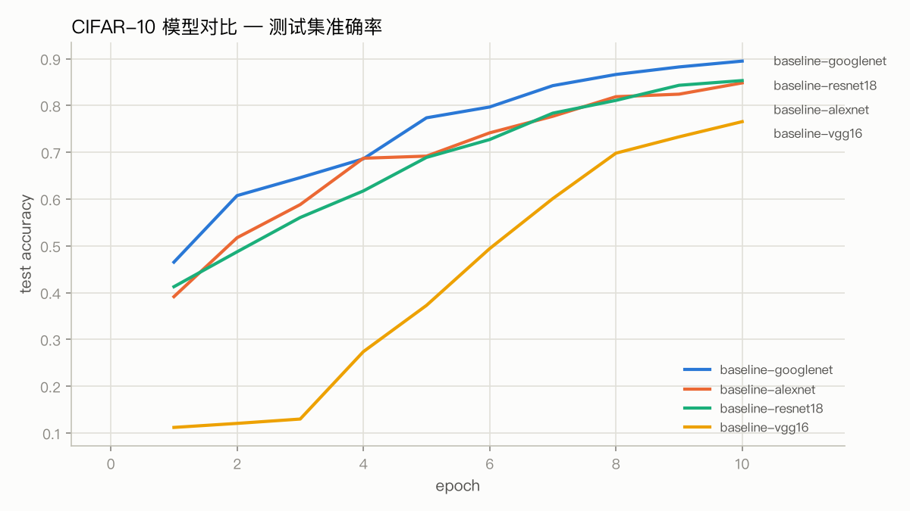
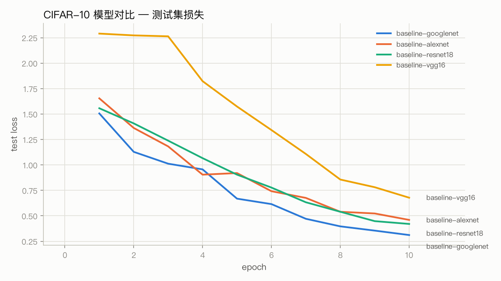
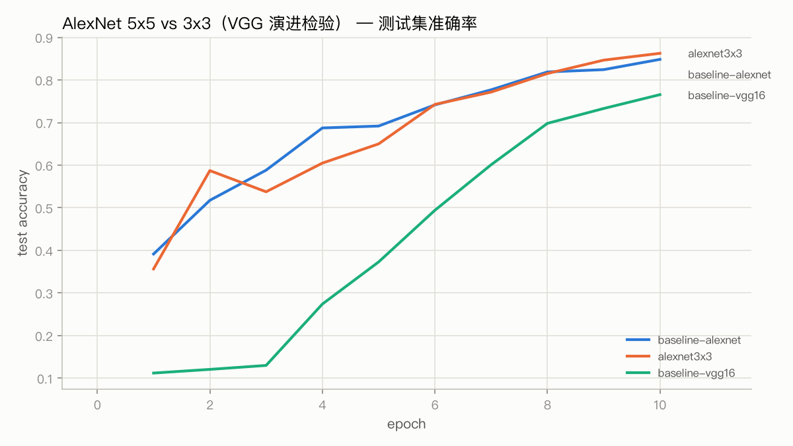
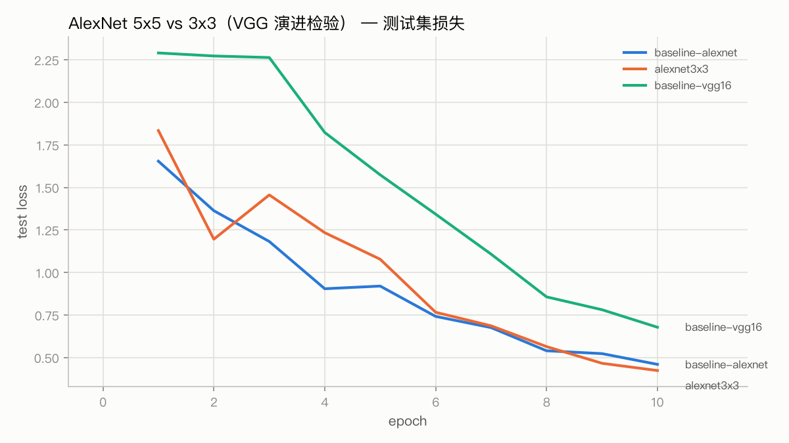
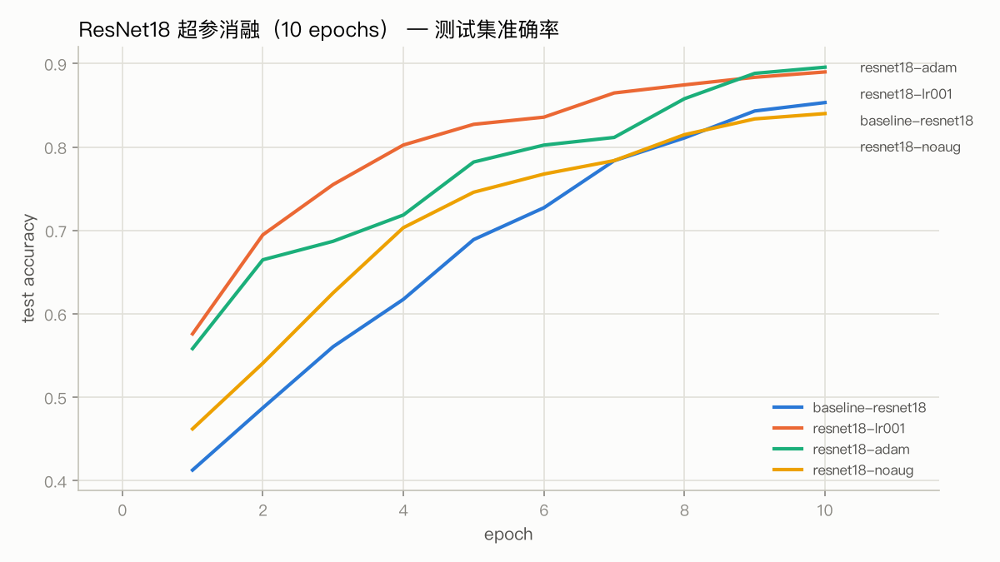
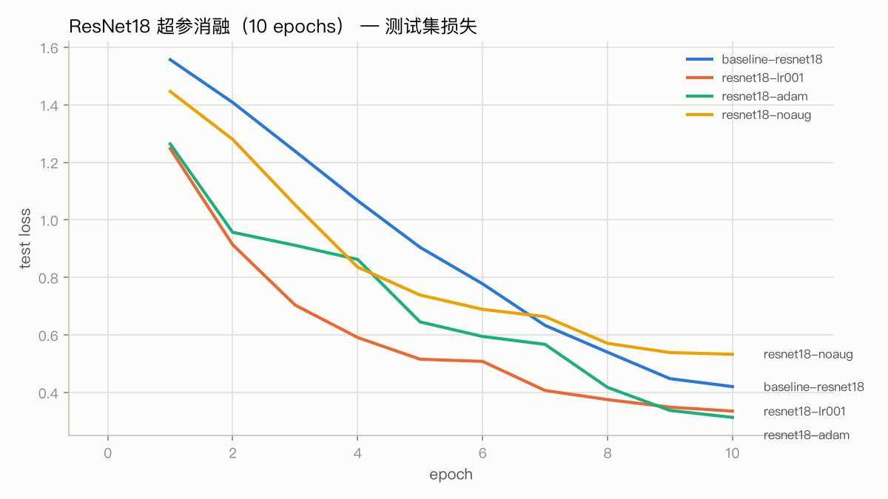
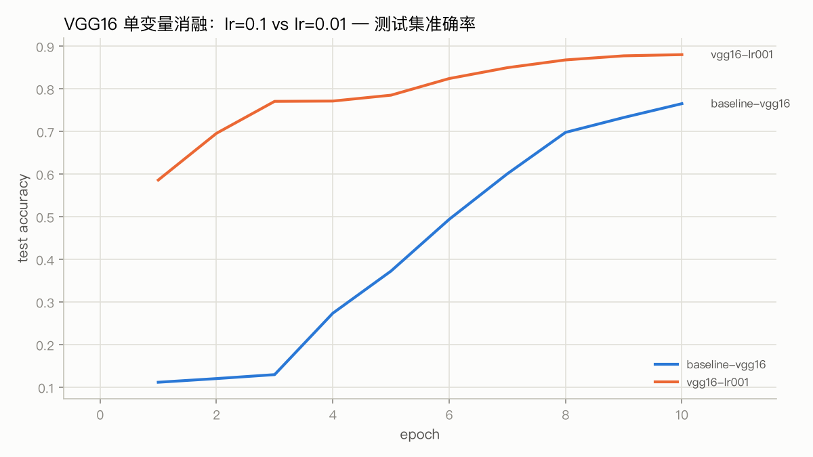
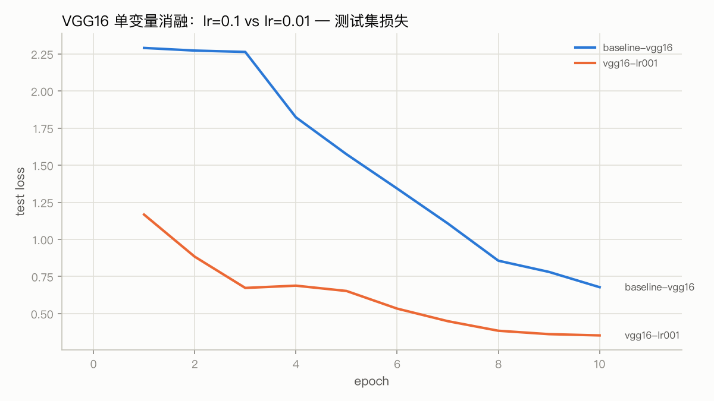

# CIFAR-10 图像分类：四种经典卷积网络对比实验报告

- 数据集：CIFAR-10（50000 训练 / 10000 测试，32x32 彩色图，10 类）
- 硬件：Mac Mini M1（16GB），PyTorch 2.13 + MPS 后端，fp32
- 统一训练配方：SGD（momentum=0.9，weight_decay=5e-4），lr=0.1 + 余弦退火，
  batch_size=128，10 epochs，数据增强（RandomCrop(32, padding=4) + RandomHorizontalFlip）
- 公平性说明：四个网络都做了 32x32 适配（裁剪下采样次数、统一加 BatchNorm）。
  AlexNet 保留它"大核 + 浅"的结构签名：首两层 5x5、后三层 3x3；另注册全 3x3
  的 alexnet3x3 作为核大小对照组（见第二节）。所有实验共用同一份数据管道与
  训练循环

## 一、四大网络基线对比

| run | 模型 | 参数量 | 计算量(MACs/样本) | 算子数 | 最优测试精度 | 末轮测试精度 | 末轮训练精度 | 秒/epoch | 总耗时(min) |
|---|---|---|---|---|---|---|---|---|---|
| baseline-googlenet | googlenet | 6.01M | 491M | 189 | 0.8950 (@10) | 0.8950 | 0.9340 | 270.6 | 45.1 |
| baseline-resnet18 | resnet18 | 11.17M | 555M | 42 | 0.8534 (@10) | 0.8534 | 0.8729 | 175.0 | 29.2 |
| baseline-alexnet | alexnet5x5 | 7.18M | 225M | 23 | 0.8484 (@10) | 0.8484 | 0.8594 | 68.1 | 11.4 |
| baseline-vgg16 | vgg16 | 14.72M | 313M | 45 | 0.7656 (@10) | 0.7656 | 0.7674 | 92.6 | 15.5 |

（四个 run 的配置完全相同：sgd lr=0.1 cosine，故不再单列。计算量为 32x32 输入
单样本前向 MACs，GoogLeNet 按训练模式含两个辅助头（各仅 ~0.1M，可忽略）；
算子数为模型内 Conv/BN/ReLU/Pool/Linear 模块总数，在 MPS eager 模式下近似
正比于 kernel launch 次数。）





### 读表须知：参数量、计算量、耗时是三件独立的事

**参数量：VGG16(14.7M) > AlexNet(7.2M) 是结构事实，原版 ImageNet 上同样如此
（138M > 60M）。** AlexNet 的"参数大户"名声来自它末尾三个大全连接头（原版 60M
参数里约 58M 在全连接）；CIFAR 适配版的 7.18M 里仍有 4.73M（66%）在全连接，
5 层卷积只占 2.45M。VGG16 正相反：适配版把它的全连接巨头（原版 7x7x512 ->
4096 x2，约 124M）换成了 512 -> 10，剩下的 14.72M 里 99.9% 是 13 层 3x3 卷积
——恰好约等于原版 VGG16 的纯卷积参数（14.71M）。比卷积网络的本体，VGG 的
卷积参数是 AlexNet 的 6 倍，一层卷积没省。

**耗时：既不跟参数量走，也不单跟计算量走，在 MPS 上主要由算子数决定。**
GoogLeNet 参数最少、计算量只排第二（491M < ResNet18 的 555M），却比 VGG16
慢 2.9 倍、比 AlexNet 慢 4.0 倍。原因：MPS eager 模式下每个 Conv/BN/ReLU 都
是一次独立的 kernel launch，GoogLeNet 有 189 个算子（VGG 的 4.2 倍、AlexNet
的 8.2 倍），且 Inception 的 4 个分支在 eager 下只能串行执行；小卷积核单核算
不满 GPU，它的有效吞吐只有 ~180 GFLOPS，其余三个都在 300-340。还有一层：
CIFAR 版 stem 不下采样，前两个 Inception 在 32x32/16x16 高分辨率上跑，所以它
的计算量其实比 VGG16（313M）还高。"参数最少"的网络在墙钟时间上可以垫底
——GoogLeNet 卖的从来是参数效率而不是速度；VGG 的大参数换来的是规则的大卷积
（对 GEMM 友好），反而是 GPU 利用率最高的结构。

### 结果分析

**1. GoogLeNet 精度最高（89.5%），且参数量最小（6.0M）。**
Inception 模块在同一层并行跑 1x1 / 3x3 / 5x5 卷积和 pool，等于让每一层同时
看多种感受野；1x1 卷积先把通道降下来再算 3x3/5x5，参数效率远高于堆大卷积核。
训练时还挂了两个辅助分类器（loss 各占 0.3 权重），相当于深监督，缓解梯度消失。
代价是最慢（271s/epoch）：189 个小算子（VGG 的 4.2 倍，见上表），MPS 上
kernel launch 开销大，机理见上面"读表须知"。

**2. AlexNet（5x5 正身，84.8%）是最快的网络，但这次被 ResNet18 反超了 0.5 个点。**
它仍是最省时的：68s/epoch，不到 ResNet18 的四成；浅（5 卷积 + 3 全连接）、
配 BatchNorm 和 Dropout 后收敛非常快，第 1 个 epoch 就到 39%。
这里有个伏笔：第二节把它首两层换回全 3x3（VGG 的规则）后，它能到 86.3% 重新
反超 ResNet18——"AlexNet 短周期性价比高"的一部分功劳，其实来自小核适配。
它的 7.18M 参数仍有 66% 在末尾三层全连接里（256x4x4 -> 1024 -> 512），
按今天的观点这是参数效率比较差的部分。

**3. ResNet18（85.3%）在这个训练长度下没有发挥出来。**
残差连接的价值在于"够深也训得动"，但 18 层在 10 epochs 内还没走到
它的精度平台——文献里同样配方法 90+ epochs 能到 92-95%。
曲线斜率到第 10 个 epoch 仍然明显为正，是四个网络里"还没训完"感觉最强的。
这次它以 0.5 个点的微弱优势压过忠实版（5x5）AlexNet，但这更多说明 5x5 大核
在 32x32 上吃亏（见第二节），而不是 ResNet18 已经发力。另一个佐证：它每
epoch 175s，耗时是 AlexNet 的 2.6 倍，性价比在短预算下不占优。

**4. VGG16 垫底（76.6%）：前 3 个 epoch 整个卡在随机水平，欠拟合而不是过拟合。**
第 1-3 个 epoch 训练精度只有 11-12%、测试损失 2.26-2.29，贴着随机猜的水平
（10 类 = 10%，ln10 ≈ 2.30）——相当于烧掉了 30% 的训练预算才开始学。
这不是 VGG 表达力不行，而是优化在起步阶段就没发生：它是四个网络里唯一的
"13 层卷积单路径串行"结构，没有残差、没有深监督，而余弦退火前 3 个 epoch
的 lr 仍在 0.08-0.10，大步长下参数一直在随机初始化平台附近打转。另外三个
各有逃生通道：AlexNet 靠浅（5 层卷积）、ResNet18 靠恒等捷径让梯度直达浅层、
GoogLeNet 靠辅助分类器把梯度注入网络中部——对照第 1 个 epoch 的测试精度：
AlexNet 39.2% / ResNet18 41.3% / GoogLeNet 46.5%，VGG 只有 11.2%。
第 4 个 epoch 起步后曲线持续陡峭上升，末轮训练精度 76.7% ≈ 测试精度 76.6%，
典型的欠拟合画像：换小学习率或加 warmup 会显著改善——参考 3.1 节，连带
残差的 ResNet18 在短预算下 lr=0.01 都比 lr=0.1 高 3.7 个点，对无残差的 VGG
这个效应只会更强；文献里同配方的 VGG16+BN 在 CIFAR-10 上能到 93%+。
这正是 ResNet 论文要解决的"深层无残差网络难训"问题的直接体现。
（这个诊断在 3.2 节被单变量实验实锤：只把 lr 降到 0.01，同一个模型 +11.5 个
点到 88.1%——是配方问题，不是结构问题。）

**5. 训练精度 vs 测试精度的差距**：只有 GoogLeNet 有明显差距
（train 93.4% vs test 89.5%，开始过拟合，但辅助分类器 + Dropout 控制住了）；
其余三个基本没有 gap，说明 10 epochs 的预算下大家都还在"学不够"阶段。

## 二、AlexNet 首两层核大小消融：VGG 设计规则的直接检验

**动机**：AlexNet 原版是 11x11 → 5x5 → 3x3 的核尺寸层级，"大核"是它的结构
签名。但 11x11 在 32x32 上没有生存空间（一层就把空间压到 6x6），如果适配时
干脆全换成 3x3，AlexNet 和 VGG 的区别就只剩深度，"VGG 用堆叠 3x3 取代大核"
这条演进主线在实验里完全不可见。所以基线的 AlexNet 用 5x5 正身（首两层 5x5、
后三层 3x3），全 3x3 版注册为 alexnet3x3 作对照：**两者除首两层核大小外完全
相同**（同通道、同 pool 位置、同配方、同 seed），唯一变量就是核大小。

先看 VGG 论文 §2.1 的算术（感受野 = 网络一层能"看到"的输入范围；C 为通道数）：

| 方案 | 感受野 | 参数量 | ReLU 次数 |
|---|---|---|---|
| 5x5 | 5 | 25C² | 1 |
| 3x3 x2 | 5 | 18C²（-28%） | 2 |
| 7x7 | 7 | 49C² | 1 |
| 3x3 x3 | 7 | 27C²（-45%） | 3 |

即：堆叠小核能在**感受野不变**的前提下，用更少参数换更多非线性。实验结果：

| run | 首两层核 | 参数量 | 其中卷积 | MACs/样本 | 秒/epoch | 最优测试精度 |
|---|---|---|---|---|---|---|
| alexnet3x3 | 3x3 | 6.98M | 2.25M | 172M | 56.8 | **0.8626** |
| baseline-alexnet | 5x5 | 7.18M | 2.45M | 225M | 68.1 | 0.8484 |





**结果：3x3 版精度更高（+1.4 个点），且参数（-3%）、计算量（-24%）、
耗时（-17%）全面更省——VGG 的核心论点在同一条骨架上被复现。** VGG 的贡献
从来不是"必然更准"，而是"同样感受野、更便宜、还能堆得更深"的设计规则；
规则成立的同时深度还能加码（5 层 → 13 层），这才是它取代 AlexNet 的方式。

逐 epoch 看两者的"性格"差异：第 1 个 epoch 5x5 领先（39.2% vs 35.7%，大核
感受野大、开局占便宜），中期互有缠斗，最后两个 epoch 3x3 拉开并保持到终点
——小核堆叠的优势是"后劲"，和论文的论证逻辑一致。

两点分寸：

- 单种子、10 epochs、1.4 个点的差距不做显著性解读；但"精度不降 + 成本全面
  更省"的效率论证不依赖统计显著性。
- 这次消融顺带改写了基线表的一个结论：忠实版 AlexNet（5x5）被 ResNet18
  反超，而 3x3 版反超回来。对照第 1 个 epoch 的起步速度（大核 39.2% > 小核
  35.7%），可以确认两组实验确实只差核大小——变量控制是干净的。

## 三、超参数实验（单变量消融）

### 3.1 ResNet18：学习率 / 优化器 / 数据增强

基线里 ResNet18 只拿到 85.3%，是"没训够"还是"学不动"？这一节固定网络结构，
每次只改一个超参（训练长度同为 10 epochs），观察精度的变化：

| run | 配置 | 最优测试精度 | 末轮训练精度 | 训练-测试差 |
|---|---|---|---|---|
| resnet18-adam | adam lr=0.001 cosine | **0.8958** | 0.9192 | 2.3 |
| resnet18-lr001 | sgd lr=0.01 cosine | 0.8901 | 0.9160 | 2.6 |
| baseline-resnet18 | sgd lr=0.1 cosine | 0.8534 | 0.8729 | 1.9 |
| resnet18-noaug | sgd lr=0.1 cosine，无增强 | 0.8402 | 0.9951 | **15.5** |





#### 结果分析

**1. 学习率：lr=0.01 比 lr=0.1 高 3.7 个点（89.0% vs 85.3%）。**
小学习率前期收敛快得多——第 3 个 epoch 就到 75.5%（lr=0.1 只有 56.1%），
整个曲线全程压制基线。原因：10 epochs 的短预算下，lr=0.1 的前半段都在
大步长"探索"，还没来得及收敛就结束了。但这不说明 lr=0.1 更差——
文献里 90+ epochs + warmup 的标准配方下 lr=0.1 通常反超到 92-95%。
**超参没有绝对的好坏，最优值依赖训练预算和调度方式**，这是本次实验最有
实操价值的结论。

**2. 优化器：Adam(lr=0.001) 拿到全场最好的 89.6%（+4.2）。**
自适应步长在短训练里同样占便宜（第 1 个 epoch 就 55.8%）。
一个细节：这里给 Adam 传的 weight_decay=5e-4 实际是 L2 正则而不是
AdamW 的解耦权重衰减，长周期训练时 Adam+L2 的泛化通常不如 SGD+momentum，
所以这个结论同样只在短预算内成立。

**3. 数据增强：去掉后测试精度只降 1.3 个点，但性质完全变了。**
无增强的 run 训练精度冲到 99.5%（第 9 个 epoch 就 97.5%），
训练-测试差拉大到 15.5 个点——教科书式的过拟合曲线。
增强版训练-测试差只有 2 个点。10 epochs 下模型还没强到能把增强后的
数据也背下来，所以测试精度差距看着不大；训练再拉长，无增强的测试精度
会原地踏步甚至回落，而增强版会继续涨。**增强是这份配方里最重要的正则项**。

### 3.2 VGG16：学习率消融（基线垫底的实锤诊断）

基线里 VGG16 垫底（76.6%，前 3 个 epoch 卡在随机水平）。逐 epoch 历史显示
失败签名是**优化问题**而非结构问题：前 3 个 epoch 训练精度 11-12%、测试损失
2.26-2.29（贴着 10 类随机的 ln10≈2.30），直到 cosine 把 lr 降下来才"起死回
生"。单变量验证——只把 lr 改成 0.01，其余全不动：

| run | 配置 | 最优测试精度 | 末轮训练精度 | 训练-测试差 |
|---|---|---|---|---|
| vgg16-lr001 | sgd lr=0.01 cosine | **0.8806** | 0.9171 | 3.7 |
| baseline-vgg16 | sgd lr=0.1 cosine | 0.7656 | 0.7656 | 0.1 |





**结果：+11.5 个点（76.6% → 88.1%），从垫底跳到全场第二**（仅次于 GoogLeNet
的 89.5%，超过基线表里其他所有网络）。空转完全消失：第 1 个 epoch 就到
58.6%（基线 11.2%），第 3 个 epoch 的 77.1% 已超过基线 10 个 epoch 的终点。
同一个模型、同一份数据、同一个训练循环，一行超参决定了 11.5 个点。

**为什么 VGG16 对学习率这么敏感，而 ResNet18 相对不敏感（+11.5 vs +3.7）？**
因为对配方的鲁棒性本身就是结构的属性。四个网络里只有 VGG16 是"13 层无残差
单路径"：ResNet18 有恒等捷径让梯度直达浅层，GoogLeNet 有辅助分类器把梯度
注入中部，AlexNet 靠浅（5 层卷积）——大学习率下它们各有"逃生通道"，VGG16
没有。这正是 ResNet 论文要解决的问题：**深度本身不难获得，难的是让无残差的
深网络对优化不敏感。**

顺便给出"各网络取各自最优配方"后的排名（各列配置不同，不能当同条件对比，
但能看各自上限）：

| 网络 | 各自最优配置 | 最优测试精度 |
|---|---|---|
| ResNet18 | adam lr=0.001 | **0.8958** |
| GoogLeNet | sgd lr=0.1（基线即最优） | 0.8950 |
| VGG16 | sgd lr=0.01 | 0.8806 |
| AlexNet | 全 3x3 版，sgd lr=0.1 | 0.8626 |

### 消融小结

- 短预算（10 epochs）：Adam ≈ lr=0.01 > lr=0.1；增强的正则作用 > 精度作用
- 敏感性因结构而异：ResNet18（有残差）lr 降一档 +3.7，VGG16（无残差单路径）
  +11.5——**最需要"对的配方"的，恰是优化通路最裸露的结构**
- 基线配方（SGD lr=0.1）是为长训练设计的，在短预算里"吃亏"：换小步长或
  自适应优化器，ResNet18 白捡 4 个点，VGG16 白捡 11.5 个点

## 四、结论

**结构对比（问题 2）**：同一配方下 GoogLeNet > ResNet18 > AlexNet > VGG16
（89.5 / 85.3 / 84.8 / 76.6）；各网络取各自最优配方后
ResNet18 ≈ GoogLeNet > VGG16 > AlexNet（89.6 / 89.5 / 88.1 / 86.3）。
两个排序拼起来的信息比任何一个都多：基线排名是"结构 x 配方"的联合结果，
配方敏感性本身就是结构的属性；参数量与精度完全不成正比——6.0M 的 GoogLeNet
赢过 14.7M 的 VGG16 和 7.2M 的 AlexNet。

**四个网络的演进过程**（2012→2015 的四步，每一步都能在本次实验里找到对应
数字）：

1. **AlexNet（2012）：把深度和非线性带进来，但设计全靠手工。** 核尺寸层级
   11x11→5x5→3x3 靠经验拍板，2/3 参数压在三个大全连接里。在 CIFAR 上的化身：
   收敛最快、单 epoch 最便宜（68s），但精度上限最低（86.3%）。
2. **VGG（2014）：把手工选择变成一条规则——同样感受野，堆 3x3 代替大核。**
   直接证据在第二节：同一骨架上，全 3x3 版用 -3% 参数、-24% 计算量、-17% 耗时
   赢了 5x5 版 1.4 个点。规则还顺带淘汰了 LRN（本次适配直接用 BN）。代价：
   13 层无残差单路径对优化最敏感——lr=0.1 时前 3 个 epoch 完全空转，
   lr=0.01 才释放出 88.1% 的深度红利（3.2 节）。
3. **GoogLeNet（2014）：不再统一用一种核，让每层并行看多种感受野。**
   Inception 的 1x1/3x3/5x5 并联 + 1x1 降通道，参数效率全场最高（6.0M 拿
   89.5%）；辅助分类器是"深监督"的最早实践。卖的是参数效率不是速度
   （189 个算子，MPS 墙钟垫底）。
4. **ResNet（2015）：解决第 2 步暴露的问题——让深度对配方免疫。** 残差连接
   让梯度直达浅层：同样的 lr=0.1，VGG16 只有 76.6%，ResNet18 有 85.3%；
   换到各自最优配方后 ResNet18 登顶 89.6%。**"VGG16@0.1 的 76.6% vs
   ResNet18@0.1 的 85.3%"这组同配方数字，就是 ResNet 论文的动机本身。**

**超参调整（问题 3）**：单变量消融的完整账本——
ResNet18：Adam(1e-3) 89.6 > lr=0.01 89.0 > lr=0.1 85.3 > lr=0.1 无增强 84.0；
VGG16：lr=0.01 88.1 > lr=0.1 76.6；AlexNet：全 3x3 86.3 > 首两层 5x5 84.8。
可迁移的教训：

① 超参好坏依赖训练预算，短训练用小步长/自适应优化器，长训练用 lr=0.1 + warmup；
② 看精度还要看训练-测试差，gap 突然拉大（2 -> 15.5）说明正则不足而不是模型不行；
③ 公平比较两个网络必须锁死数据管道和训练配方，否则比的是配方不是结构；
④ 反过来，只锁死一个配方也会冤枉结构——给每个网络各自合理的配方再排一次，
   才能看到结构的真实上限（VGG16 因此从垫底回到 88.1%）；
⑤ 感受一条"演进"的价值要靠控制变量的消融（同骨架只换核大小），而不是读结论。

**局限**：10 epochs 是算力（M1 上各模型 1-4.5 分钟/epoch）与作业周期妥协的
结果，所有 run 末轮仍在上升，排序只代表"短周期表现"；单种子单次运行，几个
点的差异不做统计显著性解读；"各自最优配方"的排名各列配置不同，只看上限。
文献里同配方 90+ epochs 的水平：VGG16+BN 与 ResNet18 都能到 93-95%。
后续若有远程算力（如 AutoDL），值得跑 90-100 epochs 验证长训排序
（预期：ResNet18 大概率登顶）。

## 附：复现方式

```bash
bash run_experiments.sh        # 全部 9 个 run 串行，约 3-3.5 小时

python compare.py              # 快速浏览所有 json
python compare.py baseline-googlenet baseline-alexnet baseline-resnet18 baseline-vgg16 --out baseline  # 第一节
python compare.py baseline-alexnet alexnet3x3 baseline-vgg16 --out kernels    # 第二节
python compare.py baseline-vgg16 vgg16-lr001 --out vgg-lr                      # 3.2 节
```

单个实验示例：

```bash
python train.py --model alexnet5x5 --tag baseline-alexnet   # AlexNet 正身（首两层 5x5）
python train.py --model alexnet3x3 --tag alexnet3x3         # 核大小对照组（全 3x3）
python train.py --model vgg16 --lr 0.01 --tag vgg16-lr001   # VGG16 的 lr 消融
python train.py --model resnet18 --lr 0.01 --tag resnet18-lr001
python train.py --model resnet18 --no-aug --tag resnet18-noaug
```
